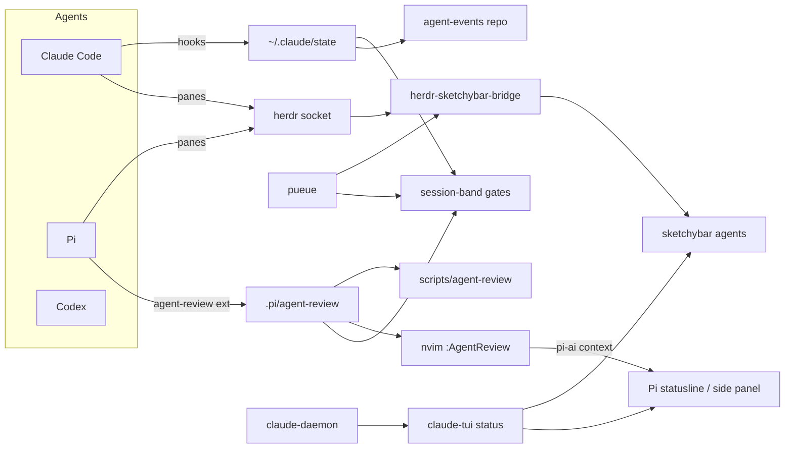

# Agent harness migration

> **Draft.** This file reports the first step (a link-view repo) and holds empty sections for the migration plan. The plan is filled in after the ideas have been grilled in the agent-harness repo. A later pass turns it into an MVP presentation for the docs site.

## Why

The agent workflow grew inside `~/dotfiles`, with more pieces in `llm-wiki/claude-setup`, sibling repos, and live config files that no repo tracks. It now spans:

- agent configuration for Claude Code, Codex, Pi and OpenCode;
- the spec loop and review gates (`ac-run`, `floor-guard`, `commit-funnel`, `agent-review`);
- Pi delegation through pueue;
- UI bridges (Neovim review gates, sketchybar via herdr, the session-band Claude mod, claude-tui).

Nobody can hold the whole thing in their head any more. The goal is a dedicated **agent-harness** repo that can grow into its own project.

## Step 1 — done 2026-10-22: link-view repo

`~/repos/agent-harness` (local only, no remote yet). Nothing was moved; dotfiles remains the live source while the workflow is still being tested.

| Piece | Role |
|---|---|
| `links.tsv` | Manifest of 43 components: harness path, source relative to `$HOME`, layer, status (`linked` / `owned`). Doubles as the migration checklist. |
| `scripts/sync-links` | Creates or repairs relative symlinks from the manifest; `--check` reports broken links. |
| `local-snapshots/` | Copies of 13 untracked live files (Pi `settings.json`/`routing.env`/`mcp.json`, Codex `config.toml`/`AGENTS.md`, judge scripts, herdr hooks). Refreshed by `scripts/snapshot-local`. No credentials. |
| `docs/inventory.md` | Full inventory, data flow and coupling report. |

### Layers linked

| Layer | Sources |
|---|---|
| Agent config | `dotfiles/{claude,codex,pi,opencode}`, `codex-guardrails-plugin` |
| Rules and skills | `dotfiles/shared`, `llm-wiki/claude-setup/{rules,skills,scripts}`, `dotfiles/llm-wiki-plugin` |
| Workflow CLIs | `dotfiles/scripts` |
| Claude mods | `dotfiles/session-band-plugin`, `~/.claude/dev-mods` |
| Bridges | nvim `agent_review*`, `agent_workflow`, `pi-status`, `pi-ai`, `commandr-board`, `evidence`, `diffviewer-local`; sketchybar `agents`, `claude_usage`; herdr config, herdr→sketchybar bridge and its launchd plist |
| Docs | `dotfiles/docs/{workflows,specs,superpowers}`, `dotfiles/specs`, top-level `docs/SPEC-*.md` |
| Sibling repos | claude-tui, agent-events, pi-live-status (not under git), DiffViewer, code-preview.nvim |

### Data flow today (draft diagram)

### Coupling found (blocks a real move)

1. About 50 hardcoded `~/dotfiles/scripts/...` paths, many inside agent rule text, plus a test that asserts the `ac-run` path.
2. A three-repo symlink loop: dotfiles links into `llm-wiki/claude-setup` for rules and skills, and `docs-sync` points back at dotfiles.
3. Untracked live state: Pi settings and routing, Codex config, judge scripts, herdr hooks, and the `pi-live-status` repo.
4. Relative symlinks inside dotfiles that depend on directory depth.
5. Stale pieces: `claude-setup/settings.json`, `install-claude-symlink.sh`, the dangling `~/.local/bin/ao`.
6. Likely bug: `pi-status.lua` reads `~/.pi/status`, while the writer uses `<cwd>/.pi/status`.

## Step 2+ — migration plan

Grilled in agent-harness on 2026-10-22. The executable spec, with a verify command for each criterion, is `SPEC.md` on the `worktree-feat+harness-orchestrator` branch of `~/repos/agent-harness` (status: draft, awaiting approval).

The migration is now the first phase of a larger goal: a **multi-machine orchestrator**. A single hub on the homelab, reachable over Tailscale, dispatches agents to SSH nodes picked by capability. For example, a monitoring agent goes to the machine with the monitoring stack, and a gateway agent goes to the machine running the AI gateway. The hub relays every message between agents and lets one Claude Code prompt session see every agent's context. Remote machines can only run the harness if it installs cleanly on its own, so the migration comes first.

### Goals

- **Nothing breaks.** Today's dotfiles workflows (spec loop, review gates, Pi delegation, hooks) keep working before, during and after every migration step.
- **The harness owns what a node needs.** That means the workflow CLIs, the rules and skills, and the Pi/Codex config. It also means a `harness install --profile node` command that sets up a fresh machine over SSH.
- **One source of truth.** Rules and skills live in one place, with no symlink loop between three repos, and no tool or rule depends on a hardcoded `~/dotfiles/scripts/` path.
- **Orchestrator, Phase B.** A single Go binary `harness` that acts as hub or node. The hub keeps a node registry (declared tags plus probed facts), a SQLite ticket and message store, an MCP server for the universal prompt session, and a kanban WebUI reachable only on the tailnet.

### Non-goals

- **The harness never carries data-plane traffic.** It owns the control plane: agent and orchestrator messages. Agents can *set up* data links (for example, shipping gateway logs to the monitoring machine), but they never carry that traffic themselves.
- **UI bridges stay put in this phase.** The Neovim, sketchybar, herdr, session-band and claude-tui bridges stay linked and move later.
- **No model-provider keys on nodes.** Nodes call the AI gateway with per-node virtual keys that the hub can revoke.
- **No public exposure.** The WebUI is single-user and reachable only on the tailnet.
- **No auto-rescheduling.** If a node fails mid-task, the ticket is parked and you're notified. It isn't re-run elsewhere, because infrastructure changes have side effects.

### Inversion order

0. **A0 — baseline gate (before anything moves).** Record today's state as passing: the dotfiles Python tests (77) and Node tests (23), a stow dry-run of the `claude` and `pi` packages, `sync-links --check` (43 links), Claude settings parse, and `pi --version`. All of these run again after every step below, and any regression blocks that step. Old `~/dotfiles/...` paths keep working through symlinks back into the harness until every consumer is updated.
1. **Workflow CLIs** (`ac-run`, `floor-guard`, `commit-funnel`, `agent-review`, …) become harness-owned behind a PATH shim. This removes the ~50 hardcoded `~/dotfiles/scripts/` paths.
2. **Rules and skills** get a single source in the harness. The `llm-wiki/claude-setup` loop is collapsed.
3. **Untracked live config** (Pi settings and routing, Codex config) is tracked without credentials. The stow conflicts that already exist in the `codex` and `shared` packages are fixed here.
4. **Node install.** `harness install --profile node` sets up a clean second machine over SSH.
5. **Phase B, MVP-1.** Two Pi agents on two nodes play message ping-pong through the homelab hub and report back to the ticket. MVP-2 is the monitoring scenario, written up as its own spec.

### Acceptance criteria

The full list, 20 criteria each with a `verify:` command, is in the agent-harness `SPEC.md`. In summary:

- **AC-1 to AC-5 (baseline).** Dotfiles tests, stow dry-run, harness links, Claude settings and the Pi CLI all pass now and stay passing.
- **AC-6 to AC-10 (Phase A).** No hardcoded dotfiles script paths remain; the CLIs sit behind the harness shim; every rules/skills row is owned; config is tracked with no credential files; node install works on a second machine (checked manually).
- **AC-11 to AC-18 (Phase B, unit level).** Go tests for message relay (direct, group, broadcast), replay after reconnect, heartbeat timeout, tag-based placement, refusal of `--dangerously-skip` without its guards, the MCP tool list, and an in-process two-node ping-pong.
- **AC-19 and AC-20 (Phase B, real hardware).** Ping-pong across two real tailnet nodes, and the kanban WebUI shown to be reachable only on the tailnet (both checked manually).

## MVP presentation (docs site)

Published as `docs/harness-migration.md` (docs site: `guides/harness-migration`). Refresh it when this plan changes.

- [x] Architecture diagram (Mermaid): layers and the repos they live in, before and after.
- [x] Data-flow diagram (refine the draft above).
- [x] Migration timeline: which component moves when.
- [x] Short explanation of each layer.
- [x] Open todos and risks.
