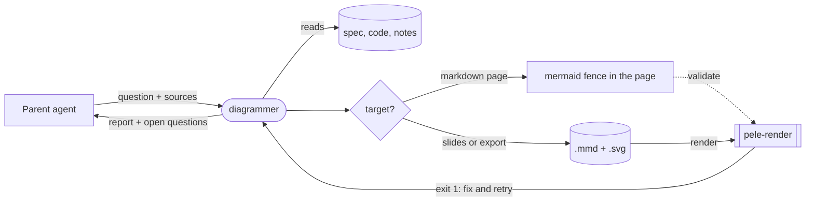

# diagrammer agent

A subagent that designs technical Mermaid diagrams: MVP overviews, system and architecture design, data flow, workflows, state machines, data models and migration timelines. It exists so diagram work for specs, wiki pages, the docs site and slides gets the same grounding and style every time, instead of being improvised inline by whichever agent is writing the page.

Added in dotfiles PR #171 (2026-10-22). First intended job: the MVP presentation section of `SPEC-HARNESS-MIGRATION.md`.

## Where it lives

The same instruction body is defined once per harness, following the `firecrawl` agent pattern. Each copy has its own frontmatter.

| Harness | Definition in `~/dotfiles` | How it reaches the harness |
|---|---|---|
| Claude Code | `claude/.claude/agents/diagrammer.md` (source copy; Sonnet, medium effort, preloads the `pele` skill) | stowed into `~/.claude/agents` |
| Pi | `pi/.pi/agent/agents/diagrammer.md` (Pi default model) | stowed into `~/.pi/agent/agents` |
| OpenCode | `opencode/.config/opencode/agents/diagrammer.md` (edits allowed; shell limited to `pele-render`, `printf`, `rg`, `fd`, `ls`) | stowed into `~/.config/opencode/agents` |
| Codex | `codex/.codex/agents/diagrammer.toml` | copied by `scripts/sync-agent-rules.sh` (Codex cannot spawn a symlinked agent) |

The agent-harness repo sees all four through its `src/agents/*` links, so it needs no change. When the migration gives rules and skills a single home (step 2 in `SPEC-HARNESS-MIGRATION.md` at the wiki root), these four copies are a candidate to generate from one source. Until then, edit the Claude copy and regenerate the others so the bodies stay identical.

Not in `~/.agents`: that folder holds cross-harness **skills** only. The `pele` skill is linked there, which is how the non-Claude harnesses get the renderer.

## How it works

1. **Ground it.** Every node and edge must come from the source material. Unclear facts are marked `?` and reported, never invented.
2. **Pick the question, then the type.** Wiring → `flowchart LR` with subgraphs per boundary; interactions over time → `sequenceDiagram`; lifecycle → `stateDiagram-v2`; data model → `erDiagram`; outsider view → C4; phases → `timeline`/`gantt`; migrations → before/after flowcharts with the same node ids.
3. **Size it.** About 9 nodes per diagram (7 for slides); larger systems become an overview plus detail diagrams.
4. **Write it where it will be read.** Markdown targets get a `mermaid` fence in the page, because Mintlify, GitHub and Obsidian render fences themselves. pele only validates the fence. Slides and exports get `.mmd` + `.svg` files.
5. **Check it** against the grounded list, and flag newer diagram types for a visual check on the published page.

House style (in the agent file, meant to be tuned): short stable node ids reused across a set; edge labels that name what moves; shapes with meaning (cylinder = store, stadium = daemon, subroutine = external); dotted edges for optional or set-up-only links; at most three `classDef` states; no hardcoded themes.

## Mermaid on the docs site

- `claude-setup/scripts/build-docs-site.mjs` copies `mermaid` fences into the `.mdx` output unchanged, and Mintlify renders them in the browser with zoom and pan controls. Fences accept `placement="top-left"` and `actions={false}`.
- So the wiki keeps Mermaid **source** in pages. It does not commit pre-rendered SVGs for pages, which would lose zoom and pan and could look different from GitHub and Obsidian (pele has its own layout engine).
- pele targets Mermaid 12.1 syntax and Mintlify ships its own Mermaid build. A fence pele accepts almost always renders on the site, but check newer types such as `architecture-beta` once they are published.

## Related pages

- [pele](/entities/pele): the renderer and validator
- [Agent Subagents](/concepts/agent-subagents): subagent format and scopes
- [Dotfiles Layout for the Agent Harnesses](/systems/dotfiles-agent-harness-layout): where agents and skills are linked
- [System Design Process](/systems/system-design-process)

## Linked pages

- [Agent Subagents](/concepts/agent-subagents)
- [Dotfiles Layout for the Agent Harnesses](/systems/dotfiles-agent-harness-layout)
- [pele](/entities/pele)
- [System Design Process](/systems/system-design-process)

<iframe srcDoc="<!doctype html><html lang=&quot;en&quot;><head><meta charset=&quot;utf-8&quot;><title>Knowledge graph</title></head>
<body>
Graph
<button type=&quot;button&quot; id=&quot;gear&quot; aria-label=&quot;Graph settings&quot; aria-expanded=&quot;false&quot; aria-controls=&quot;panel&quot;>⚙</button>

<label for=&quot;ns&quot;>Node size</label><input id=&quot;ns&quot; type=&quot;range&quot; min=&quot;0.6&quot; max=&quot;6&quot; step=&quot;0.2&quot;>
<label for=&quot;lw&quot;>Link width</label><input id=&quot;lw&quot; type=&quot;range&quot; min=&quot;0&quot; max=&quot;3&quot; step=&quot;0.1&quot;>
<label for=&quot;ts&quot;>Label size</label><input id=&quot;ts&quot; type=&quot;range&quot; min=&quot;0&quot; max=&quot;8&quot; step=&quot;0.5&quot;>
<label for=&quot;to&quot;>Label opacity</label><input id=&quot;to&quot; type=&quot;range&quot; min=&quot;0&quot; max=&quot;1&quot; step=&quot;0.05&quot;>

<label for=&quot;dp&quot;>Depth</label><input id=&quot;dp&quot; type=&quot;range&quot; min=&quot;1&quot; max=&quot;5&quot; step=&quot;1&quot;>

<label class=&quot;row&quot;><input id=&quot;ar&quot; type=&quot;checkbox&quot;>Directional arrows</label>
<label for=&quot;sz&quot;>Panel size</label><input id=&quot;sz&quot; type=&quot;range&quot; min=&quot;220&quot; max=&quot;720&quot; step=&quot;20&quot;>
<button type=&quot;button&quot; id=&quot;reset&quot;>Reset position and size</button>

</body></html>" title="Knowledge graph (visual). The same links are listed under Linked pages." loading="lazy" className="llmwiki-graph" />
