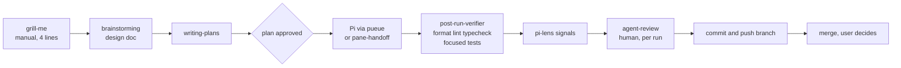
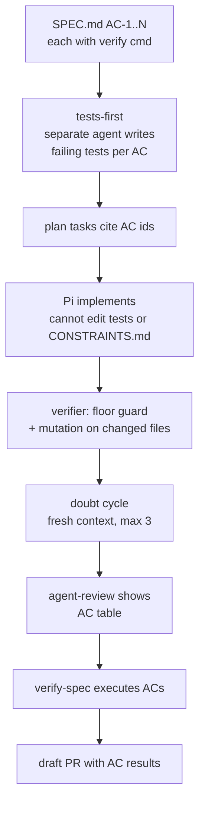

# Spec Conformance and Review Loop Options

Viet's working consensus: `grill-me` is the best part of the workflow, but testing, spec conformance and review loops are thin across the rest of the cycle. This page records the current model as inventoried on 2026-10-15, the verified gaps, and three refactor options. It began as a decision aid. Option 1 was then built (see "Built" below); Options 2 and 3 remain unadopted. The build is live: both PRs were merged on 2026-10-15 and the post-merge steps (symlink retarget, bootstrap, rule sync) were run and verified.

## Current model (inventoried from ~/dotfiles and ~/.claude)

| Phase | Covered by | State |
|---|---|---|
| Define | `grill-me` (manual trigger, relaxed mode), superpowers brainstorming | Works; no output artifact |
| Spec | `shared/templates/spec.md` (has Conformance Criteria), brainstorming design docs | Template exists; nothing generates a spec from a grill (to-prd was deleted) |
| Plan | superpowers writing-plans, plan-handoff | Covered |
| Build | Pi dispatch, Claude `worker`, worktrees | Covered |
| Test | Pi `post-run-verifier` (tests run only for behavioral change with nearby coverage), `verify-spec` | Thin |
| Review | agent-review (human), pi-lens, `/judge`, council, `/code-review` | Many gates, one real enforcement point |
| Ship | auto commit/push on branches, deny push to main, gh-stack, optional pre-commit gate | Partial; CI covers only ansible, macOS bootstrap and the wiki |
| Operate | nothing | Sentry MCP configured, no rule or skill uses it |

## Verified gaps

Each was checked against the file itself, not only the inventory.

1. **grill-me ends in conversation.** `claude-setup/skills/grill-me/SKILL.md` is four lines with no output step. The decisions live in chat and are lost unless another skill captures them. Source of the lean-workflow `grill → PRD` hand-off (`to-prd`) no longer exists.
2. **Acceptance criteria are not a durable, checkable contract.** `verify-spec` resolves a spec from a branch-named GitHub issue or `docs/superpowers/specs/*.md`, then a subagent judges each AC by reading code. Its own notes say "reads code, doesn't run it", and runtime ACs fall to UNVERIFIABLE. Test stubs are generated only after an AC fails, and only if the user says yes. It is manual.
3. **The implementer writes its own tests and nothing grades them.** The Pi verifier runs tests, but a vacuous test passes. There is no oracle-strength, mutation or invert-the-condition check ([Agent Test Verification](/concepts/agent-test-verification): 80.2% of agent test patches have weak or no oracle signals).
4. **Nothing guards against gaming.** `protect-lint-configs.sh` blocks edits to lint configs. Nothing flags deleted or skipped tests, lowered thresholds, or new suppression comments.
5. **Review has many gates but one hard one, and no bounded loop.** agent-review is a strong human gate per run. `/judge` is manual, the `bin/council` script is missing from dotfiles (it exists in `~/repos/Commandr/bin/council`), and no skill defines a doubt cycle with a stop rule.
6. **No Operate phase.** No post-merge verification, rollback or monitoring workflow.
7. **No single lifecycle doc.** The closest is [Lean Agentic Coding Workflow](/syntheses/lean-agentic-workflow), which still names tools the inventory did not find installed (`to-prd`, `/issues`, dangeresque, OpenCode plugins). Flagged for a separate cleanup; not changed here.
8. **Skills are untested.** Skill invocation is stochastic and wording-sensitive (agent-skills reports routing gains from one clause, author-reported). Our trigger wording for grill-me and verify-spec has no eval.

## The constraint that shapes every option

The core budget is `skills 22/22, agents 0/0, rules 5/4, hooks 16/18` (session-start hook, `trial-expiry.sh`). Installing the 25-skill pack wholesale would blow the skill budget and duplicate superpowers (brainstorming, TDD, verification-before-completion, review). So every option below ports mechanics into existing skills, rules and hooks instead of adding a pack. This matches [Spec-Driven Frameworks vs Native Claude Code](/comparisons/spec-driven-frameworks-vs-native): heavy frameworks cost 4 to 5 times the tokens of lean skills.

## Option 1 — Harvest: amend four existing things (smallest)

| Change | Where | Source mechanic |
|---|---|---|
| grill-me ends by writing `SPEC.md`: Objective, ACs each with a verify command, Boundaries (Always/Ask first/Never), Open Questions; then STOP and wait for approval in a later turn | `grill-me/SKILL.md` | agent-skills `spec-driven-development`, `interview-me` |
| `verify-spec` runs each AC's command and records exit code and output; UNVERIFIABLE only when no command exists | `verify-spec/SKILL.md` | Aviator runtime verifier, agent-skills Verification |
| Floor guard: new `CONSTRAINTS.md` plus a diff scan for deleted or skipped tests, lowered thresholds, new suppressions, empty catches; extend `protect-lint-configs.sh` to guard `CONSTRAINTS.md` | hook + one file per repo | agent-skills `constraint-driven-development` |
| Add a Rationalizations table (excuse and rebuttal) to grill-me and verify-spec | the same skills | agent-skills skill anatomy |

Cost: edits to two skills, one hook, one template. No new skills or agents. Risk: ACs written by the model during grill may be vague; the "STOP for approval" gate is the mitigation.

## Option 2 — Spec spine: one contract flows through every phase

Option 1, plus the AC ids travel with the work.

Additions over Option 1: tests-first by a different agent than the implementer (the agent-review work order already does this ad hoc for integration tests Pi must not edit); mutation score on changed files as a verifier stage (start at 60%, ratchet); a doubt cycle defined as a skill section with the stop rules (trivial only, 3 cycles, or user stop) and the "doubt theater" red flag; a PR template that carries the AC table. Cross-vendor review stays optional, because the one controlled study found it asymmetric ([Agent Test Verification](/concepts/agent-test-verification)).

Cost: one new verifier stage, one prompt change in plan-handoff, one PR template, one doubt section. Risk: process weight grows; mutation runs add minutes per turn on large diffs.

## Option 3 — Gated pipeline with Operate

Option 2, plus enforced phase state: `.agents/phase.json` with transitions blocked by hooks and the pre-commit gate (no BUILD without an approved SPEC, no PR without all ACs PASS), and an Operate phase (post-merge smoke test, Sentry query for new errors, rollback note).

Cost: highest, and Operate has no target today. The inventoried repos are dotfiles and a wiki, which have no deployed service for smoke tests or Sentry to watch. Building Operate now is speculative (YAGNI). Phase enforcement also repeats the ceremony problem of heavy frameworks.

## Recommendation

Do Option 1 now. Pilot Option 2 on the next real code feature and keep the evidence: AC count, ACs passing first run, mutation score before and after, doubt-cycle findings classified actionable vs noise, human minutes in agent-review. Adopt the Option 2 parts that moved those numbers. Defer Option 3 until a deployed service exists; if so, add only the post-merge smoke test and a Sentry check, not phase locks.

Also worth doing regardless: a small routing eval for the grill-me and verify-spec descriptions, because trigger wording changes fire rates (agent-skills approach: positive prompts must rank their skill, negative prompts must hand off). `(claimed, unverified)` for the magnitude; the direction is consistent with [Agent Skills](/concepts/agent-skills).

## Built: Option 1 plus baseline classification (2026-10-15)

Option 1 was narrowed by two adversarial grill rounds, built tests-first, and hardened by three fresh-context review cycles. It lives in the dotfiles repo (PR vietbui1999ru/dotfiles#83, merged); this repo only moved the two skill sources (PR #36, merged).

What shipped:

- `scripts/ac-run` (`lint`, `approve`, `check`) and `scripts/floor-guard`, Python standard library only. About 490 lines of scripts and 640 of tests, against a target of 350 and 200; the review rounds account for most of the growth.
- `grill-me` ends by writing a lint-clean `SPEC.md` (acceptance criteria each with a verify command, `branch:` in the frontmatter) and stops. `verify-spec` runs `ac-run check` and `floor-guard` first, reads code only for manual ACs, and caps the fix loop at 3. Both now live in dotfiles `shared/skills` so Codex, OpenCode and Pi see them through `~/.agents/skills` (the old locations here hold `MOVED.md`).
- One spec-loop rule block in `shared/research-tool-routing.md`, hand-mirrored into `shared/AGENTS.md`.

What was cut from the agreed Option 1 and why:

- Terminal-bound approval: an agent with a shell forged it in one line (`script`, `expect`). Approval is now an honour system: the hash record only stops a human running `check` on a spec they never saw.
- The command denylist (noisy and evadable), `sandbox-exec`, and `CONSTRAINTS.md` with its exceptions table.

What the evidence says:

- 31 tests pass; 12 automated build ACs pass from the build's own `SPEC.md`.
- Cycle 2 of the review found a regression in the first fix, and showed that regression tests written after a fix had never been seen failing. The repair was redone tests-first, with three checks confirmed red before any fix. Cycle 3 killed 26 of 28 mutants; the two survivors are an equivalent mutant and a memory-only change.
- Running `floor-guard` on its own branch found a false positive no test had caught (`xit(` matching `sys.exit(`).
- Local models (non-gating): `gemma4:e4b` wrote a lint-clean spec on the first try once its reasoning text was hidden (`--think=false --hidethinking`); `qwen2.5:3b` did not, even after one repair turn using only the lint messages. No harness is configured to use ollama, so end-to-end local-model use is untested.
- Untestable today for every provider: whether a model actually stops after the spec or runs the checks before claiming done.

Two deliberate departures from the agreed spec text: rule 3 now says a run asked to write a spec stops at a draft while a run asked to implement an approved spec proceeds (the implementation run is itself a pueue dispatch), and `verify-spec` allows one test edit, replacing the placeholder body of a stub written for the spec.

### Scope decisions (owner, 2026-10-15)

- **Frontier providers only.** The loop is for Claude Code, Codex and OpenCode. Pi runs it when it dispatches to their models.
- **Local models are not a target.** A local model (ollama on this machine) would be used for dispatches only if it can do the job, and the owner expects the cheap hosted models (Haiku 5.5, the OpenCode Go models) to be both cheaper and better. No harness is wired to ollama. The smoke result above is informational: the grammar is workable for a 4B-class model (`gemma4:e4b`) and not for a 3B one (`qwen2.5:3b`).
- **Mutation testing is deferred** to its own session after the refactor and clean-ups. Until then the baseline classification only catches acceptance criteria that were already true before the change, not weak assertions.

### Still open

The Option 2 pilot repo (the first real use of the loop on a code feature has not happened yet: no approval record has ever been written), whether `/judge` stays a manual gate, and a routing eval for the two skill descriptions.

## Open questions for Viet

- Which repo is the pilot? Spec-conformance needs a code project with runnable tests; dotfiles and the wiki fit only scripted ACs (shellcheck, link checks, `qmd` queries).
- Should ACs be written by the model after grill and approved by Viet (cheap, agrees with agent-skills and Spec Kit), or hand-written (stronger, slower)? Aviator's product docs generate criteria from the built code, which is circular and not recommended here.
- Is the Gemini `/judge` gate worth keeping as a manual step, or fold it into the doubt cycle?

## Related

- Addyosmani Agent Skills — the mechanics ported above
- Aviator Spec Driven Verification — measured spec-first case
- [Agent Test Verification](/concepts/agent-test-verification) — evidence on test strength and review
- [Lean Agentic Coding Workflow](/syntheses/lean-agentic-workflow) — the earlier workflow; needs reconciling with installed tools
- [Verification Pipeline](/concepts/verification-pipeline), [Agentic CI/CD](/concepts/agentic-cicd), [AI Code Review](/concepts/ai-code-review)

## Linked pages

- [Agent Skills](/concepts/agent-skills)
- [Agent Test Verification](/concepts/agent-test-verification)
- [Agentic CI/CD](/concepts/agentic-cicd)
- [AI Code Review](/concepts/ai-code-review)
- [Lean Agentic Coding Workflow](/syntheses/lean-agentic-workflow)
- [Spec-Driven Frameworks vs Native Claude Code](/comparisons/spec-driven-frameworks-vs-native)
- [Verification Pipeline](/concepts/verification-pipeline)

<iframe srcDoc="<!doctype html><html lang=&quot;en&quot;><head><meta charset=&quot;utf-8&quot;><title>Knowledge graph</title></head>
<body>
Graph
<button type=&quot;button&quot; id=&quot;gear&quot; aria-label=&quot;Graph settings&quot; aria-expanded=&quot;false&quot; aria-controls=&quot;panel&quot;>⚙</button>

<label for=&quot;ns&quot;>Node size</label><input id=&quot;ns&quot; type=&quot;range&quot; min=&quot;0.6&quot; max=&quot;6&quot; step=&quot;0.2&quot;>
<label for=&quot;lw&quot;>Link width</label><input id=&quot;lw&quot; type=&quot;range&quot; min=&quot;0&quot; max=&quot;3&quot; step=&quot;0.1&quot;>
<label for=&quot;ts&quot;>Label size</label><input id=&quot;ts&quot; type=&quot;range&quot; min=&quot;0&quot; max=&quot;8&quot; step=&quot;0.5&quot;>
<label for=&quot;to&quot;>Label opacity</label><input id=&quot;to&quot; type=&quot;range&quot; min=&quot;0&quot; max=&quot;1&quot; step=&quot;0.05&quot;>

<label for=&quot;dp&quot;>Depth</label><input id=&quot;dp&quot; type=&quot;range&quot; min=&quot;1&quot; max=&quot;5&quot; step=&quot;1&quot;>

<label class=&quot;row&quot;><input id=&quot;ar&quot; type=&quot;checkbox&quot;>Directional arrows</label>
<button type=&quot;button&quot; id=&quot;reset&quot;>Reset position</button>

</body></html>" title="Knowledge graph (visual). The same links are listed under Linked pages." loading="lazy" className="llmwiki-graph" />
