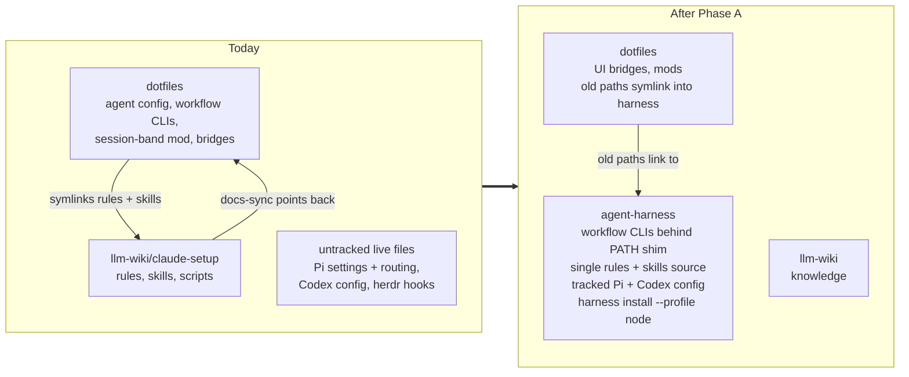
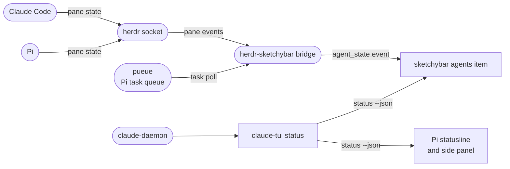
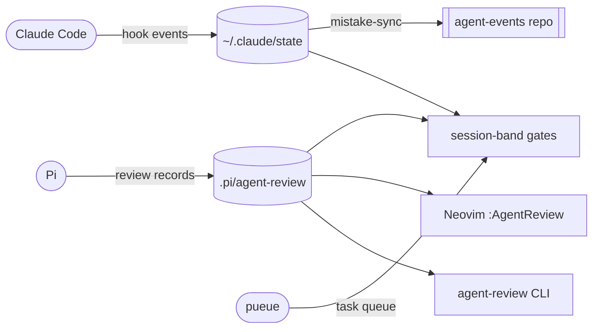
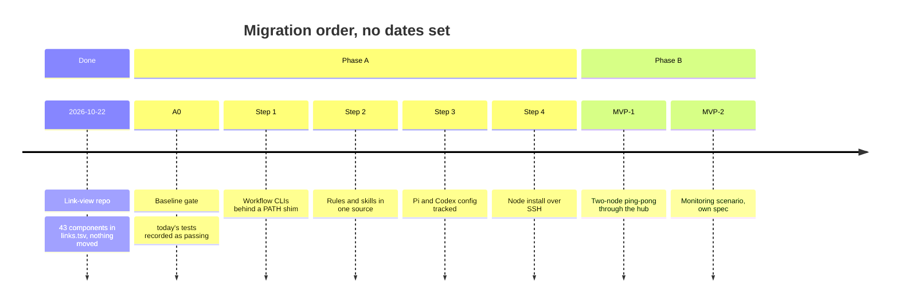
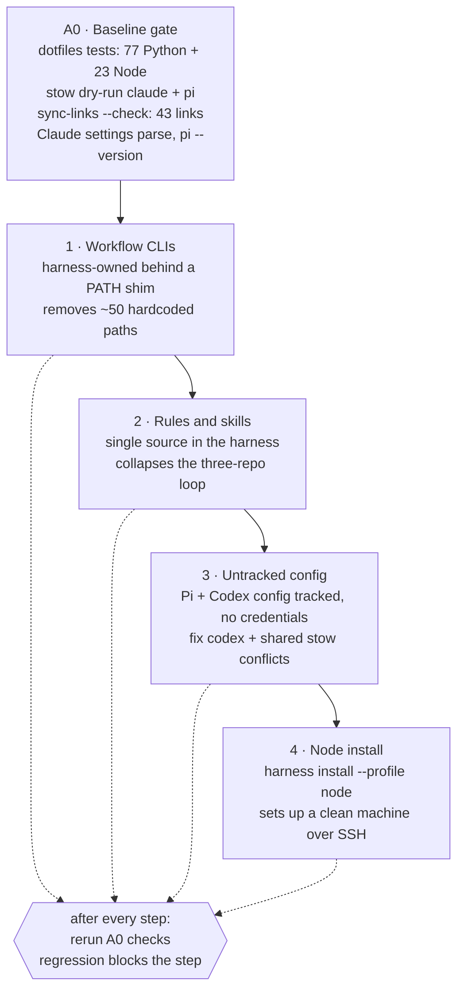
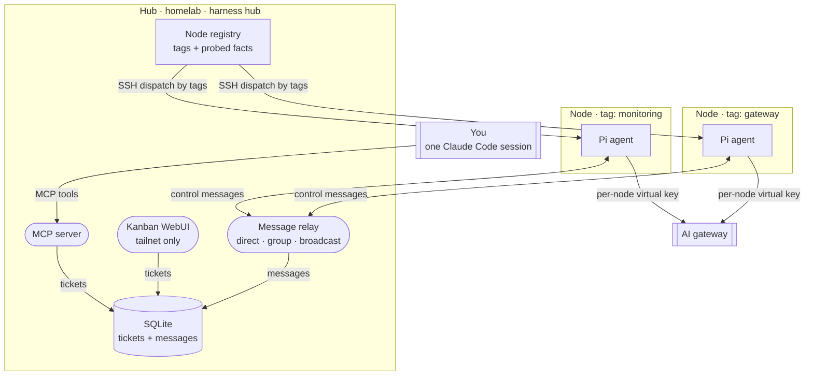
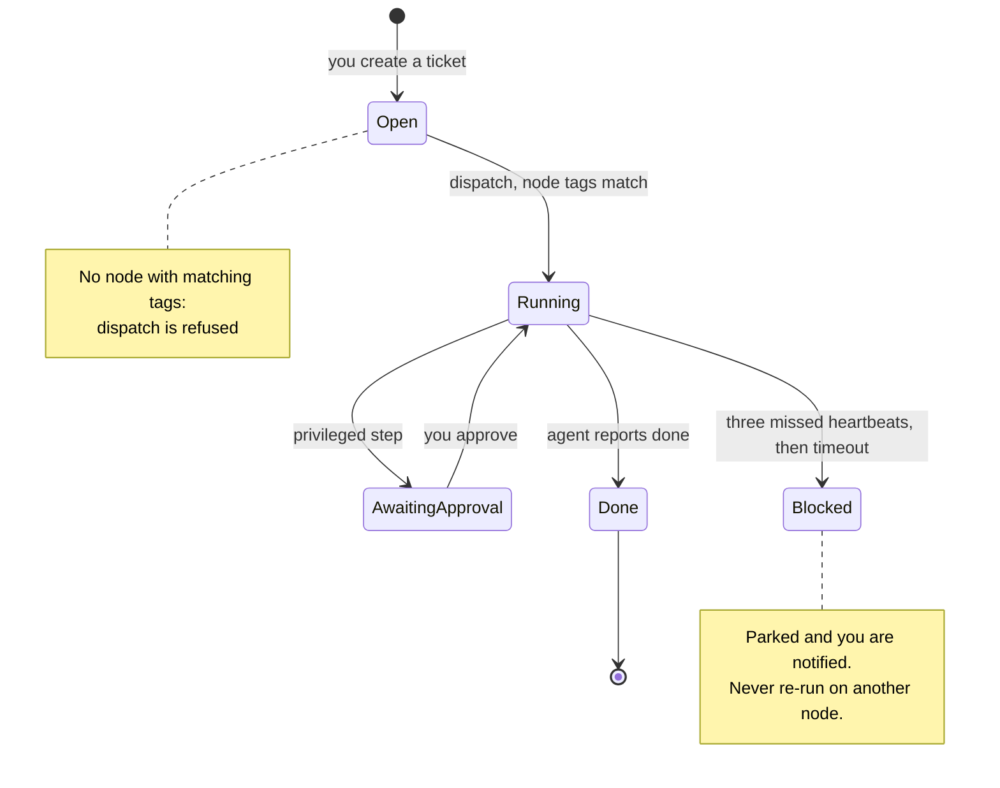
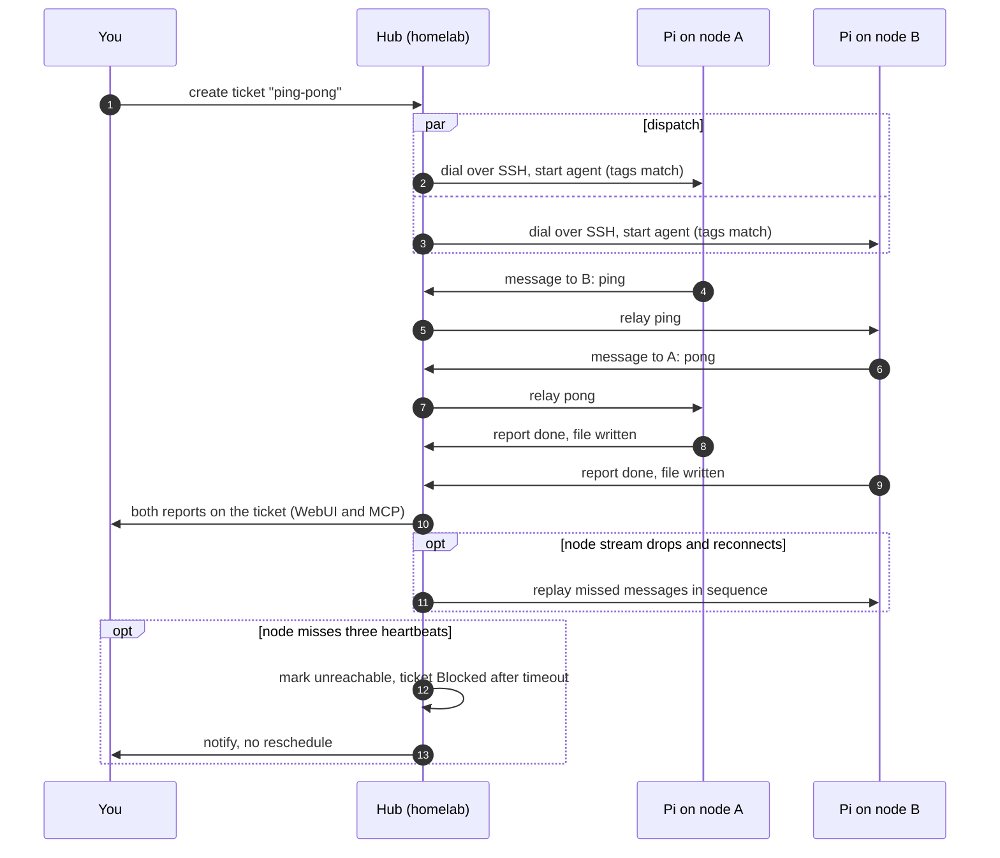

# Agent Harness Migration (Planned)

> **Planned change, under development.** Nothing described below the "Where it stands" section has been built yet. The source of truth is `SPEC-HARNESS-MIGRATION.md` in this repo, and the executable spec (20 acceptance criteria, each with a `verify:` command) lives on the `worktree-feat+harness-orchestrator` branch of `~/repos/agent-harness`, status draft. This page is a simplified presentation; when the two disagree, the spec wins.

The agent workflow (configs, rules, skills, review gates, Pi delegation and UI bridges) grew inside `~/dotfiles`, with more pieces in `llm-wiki/claude-setup`, several sibling repos, and live config files that no repo tracks. The plan moves it into a dedicated **agent-harness** repo, then grows that repo into a **multi-machine orchestrator**: one hub on the homelab that dispatches agents to other machines over Tailscale.

Related guides: [Architecture](/guides/architecture) (how the harness fits together today) and [Standard workflow](/guides/workflows) (the spec loop the migration must not break).

---

## Why

- **Sprawl.** The workflow spans four agents (Claude Code, Codex, Pi, OpenCode), the spec loop and review gates, Pi delegation through pueue, and UI bridges in Neovim, sketchybar, herdr and claude-tui. Nobody can hold it in their head any more.
- **Coupling.** About 50 hardcoded `~/dotfiles/scripts/...` paths, many inside agent rule text, and a symlink loop between three repos.
- **No clean install.** A second machine cannot run the workflow, because part of it is untracked live state. That blocks the orchestrator, which needs remote nodes to install the harness on their own.

## The layers

The harness is made of six layers. The names match the `layer` column of `links.tsv`.

- **Agent config.** Settings, hooks, agent definitions and extensions for Claude Code, Codex, Pi and OpenCode, today under `dotfiles/{claude,codex,pi,opencode}` plus the Codex guardrails plugin. Pi settings and routing and the Codex config exist only as untracked live files.
- **Rules and skills.** The shared `AGENTS.md`, research-tool routing and skills such as `delegate-pi`, `grill-me` and `pele`, split between `dotfiles/shared` and `llm-wiki/claude-setup` (12 rules, 17 skills). Dotfiles links into llm-wiki, which is the source of the symlink loop.
- **Workflow CLIs.** The commands that run the spec loop and review gates: `ac-run`, `floor-guard`, `commit-funnel`, `agent-review`, plus session and hook helpers, all in `dotfiles/scripts`.
- **Claude mods.** Plugins that change Claude Code's own interface, mainly the `session-band` mod, which reads pueue, Pi sessions and `~/.claude/state` to show gates and running tasks.
- **UI bridges.** Neovim review gates and boards, the sketchybar agents item, and the herdr-to-sketchybar bridge. They show agent state on screen and do not hold workflow logic.
- **Sibling repos.** Projects with their own repo that the workflow consumes: `claude-tui`, `agent-events`, `pi-live-status` (not under git), `DiffViewer` and `code-preview.nvim`.

Docs and specs ride along in the manifest too, and runtime state (`.agents/`, `.pi/`, `~/.claude/state/`) is deliberately never versioned.

## Where it stands

**Step 1 is done (2026-10-22): a link-view repo.** `~/repos/agent-harness` exists locally with no remote. Nothing has moved; dotfiles is still the live source.

| Piece | Role |
|---|---|
| `links.tsv` | Manifest of 43 components: path, source, layer, status (`linked` or `owned`). Doubles as the migration checklist. |
| `scripts/sync-links` | Creates or repairs the symlinks from the manifest; `--check` reports broken ones. |
| `local-snapshots/` | Copies of 13 untracked live files (Pi and Codex config, judge scripts, herdr hooks). No credentials. |
| `docs/inventory.md` | Full inventory, data flow and coupling report. |

Every component is `linked` today. The migration flips rows to `owned`, one layer at a time.

---

## Chart 1 — Who owns what, before and after Phase A

Question: after Phase A, which repo owns each layer? Today ownership is split across three repos plus untracked files, with a loop between dotfiles and llm-wiki. After Phase A the harness owns everything a node needs; the UI bridges stay in dotfiles for now.

| Layer | Today | After Phase A |
|---|---|---|
| Agent config (Claude, Codex, Pi, OpenCode) | dotfiles, partly untracked | harness, tracked, no credentials |
| Rules and skills | llm-wiki `claude-setup`, linked from dotfiles | harness, one source |
| Workflow CLIs (`ac-run`, `floor-guard`, `commit-funnel`, `agent-review`) | `dotfiles/scripts`, called by hardcoded path | harness, found on `PATH` through a shim |
| Claude mods (session-band) | dotfiles | unchanged (later phase) |
| UI bridges (Neovim, sketchybar, herdr) | dotfiles | unchanged (later phase) |
| Sibling repos (claude-tui, agent-events, and others) | their own repos | unchanged |

## Chart 2 — How agent status reaches the menu bar and statusline

Question: which pieces carry "what are my agents doing" from the agents to the UI? The migration changes where these pieces live, not how they talk; this flow must still work after every step.

## Chart 3 — Where review and hook state is read

Question: who consumes the files the agents write? Claude hooks write session state; the Pi `agent-review` extension writes review state; four different readers depend on those paths, which is why the paths must keep working during the move.

---

## Chart 4 — Roadmap

Question: what lands in what order, from the link-view repo to the first orchestrator scenarios? No dates are set yet; the order comes from the spec's inversion order.

## Chart 5 — Phase A migration order

Question: how does each Phase A step stay safe? Each step is gated by the same baseline. A0 records today's state as passing; every later step reruns it, and any regression blocks that step. Old `~/dotfiles/...` paths keep working through symlinks into the harness until every consumer is updated.

---

## Chart 6 — Phase B: the orchestrator

Question: what runs where once a node can install the harness by itself? The same Go binary, `harness`, runs in two roles. The **hub** on the homelab keeps a node registry (declared tags plus probed facts), a SQLite store of tickets and messages, an MCP server so one Claude Code session can see every agent's context, and a kanban WebUI. **Nodes** are machines the hub reaches over SSH on the tailnet; the hub places an agent on the node whose tags match the job, for example a monitoring agent on the machine with the monitoring stack. The tag names below are examples.

Design boundaries:

- **Control plane only.** The hub relays agent and orchestrator messages. Agents may *set up* data links, such as shipping gateway logs to the monitoring machine, but the harness never carries that traffic.
- **No provider keys on nodes.** Nodes call the AI gateway with per-node virtual keys the hub can revoke.
- **Tailnet only.** The WebUI is single-user and not exposed publicly.
- **No auto-rescheduling.** If a node fails mid-task, the ticket is parked and you are notified. Infrastructure work has side effects, so it is never silently re-run elsewhere.
- **Privileged steps need a human.** Agents run as an unprivileged user, and `--dangerously-skip` is refused on the hub and on any node without its guards.

## Chart 7 — Ticket lifecycle

Question: what states can a ticket be in, and what moves it? The spec names only the Blocked column and the approval step; the other state names are working labels for the lifecycle it describes, to be checked against the WebUI once it exists.

## Chart 8 — MVP-1: message relay between two nodes

Question: what happens, in order, in the first end-to-end proof? Two Pi agents on two different nodes exchange messages only through the hub, and the result lands on the ticket. The hub dials the nodes over SSH; nothing listens on a node. MVP-2, the monitoring scenario, gets its own spec.

---

## How "done" will be checked

The agent-harness spec has 20 acceptance criteria. Grouped:

| Criteria | Scope | How checked |
|---|---|---|
| AC-1 to AC-5 | Baseline: dotfiles tests, stow dry-run, harness links, Claude settings, Pi CLI | Commands, now and after every step |
| AC-6 to AC-10 | Phase A: no hardcoded script paths, CLIs behind the shim, rules and skills owned, config tracked without credentials, node install | Commands; node install checked by hand on a second machine |
| AC-11 to AC-18 | Phase B units: message relay, replay after reconnect, heartbeat timeout, tag placement, guarded `--dangerously-skip`, MCP tool list, in-process ping-pong | Go tests |
| AC-19 to AC-20 | Phase B on real hardware: ping-pong across two tailnet nodes, WebUI reachable only on the tailnet | By hand |

## Risks and open items

- **Hidden consumers of old paths.** Rule text and one test assert `~/dotfiles/scripts/ac-run`. The compatibility symlinks must stay until a search shows zero consumers.
- **Relative symlinks inside dotfiles** depend on directory depth and can break when a package moves.
- **Untracked state.** `pi-live-status` is not under git, and Pi, Codex, judge and herdr files exist only as snapshots.
- **Stale pieces** to delete during the move: `claude-setup/settings.json`, `install-claude-symlink.sh`, a dangling `~/.local/bin/ao`.
- **Likely bug found during the inventory:** `pi-status.lua` reads `~/.pi/status` while the writer uses `<cwd>/.pi/status`.
- **Open:** the spec is still a draft awaiting approval; the agent-harness repo has no remote yet; the UI-bridge move is unscheduled.
