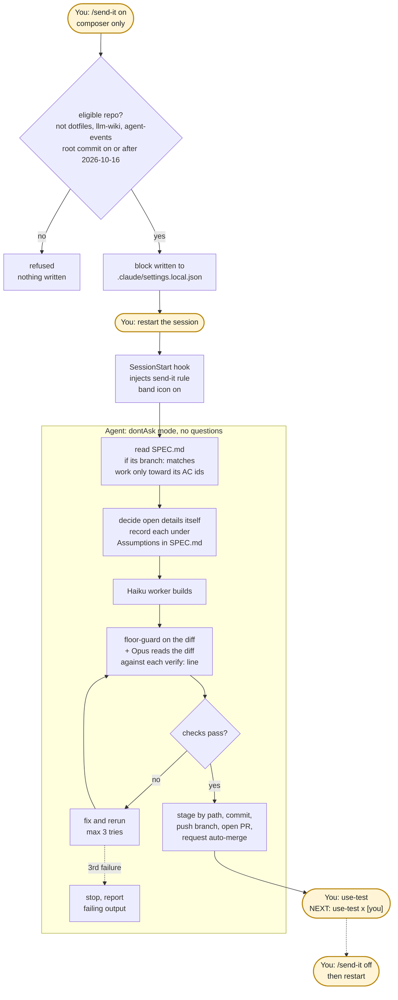

# send-it: Vibecode Mode

send-it is an unattended mode for new, throwaway repositories. While it is on, the agent does not ask questions, does not wait for approvals, and ships its work as a pull request with auto-merge requested. The only human gate is the **use-test**: you try the result and decide whether it works.

It is the opposite end of the dial from the [standard workflow](/guides/workflows), where a human approves the spec, every acceptance criterion runs as a command, and a human reviews each Pi run before anything is pushed.

Sources: the rule text in `claude-setup/rules/send-it.md` (this repo), and the session-band mod in dotfiles: `session-band-plugin/hooks/send-it.ts` (pure core), `send-it.tsx` (command and hooks), and `scripts/cloud/send-it-setup.sh` (Claude Code on the web).

---

## Chart 1 — send-it Run

Yellow nodes are the human's. Everything inside the box runs without prompting.

---

## Turning it on and off

| Step | What happens |
| --- | --- |
| `/send-it on` | Typed by the person at the composer. The command refuses any other origin, so an agent or script cannot turn it on. |
| Eligibility | Refused in `~/dotfiles`, `~/repos/llm-wiki` and `~/repos/agent-events`. Otherwise the repo's root commit must be on or after `2026-10-16T00:00:00Z`. An empty repo is eligible. |
| Write | Merges the send-it block into the repo's `.claude/settings.local.json`. If a key already holds a different value (`model`, `sandbox`, `env.SEND_IT`, `env.SEND_IT_ENV`, `permissions.defaultMode`), it refuses and names the keys, never their values. |
| Restart | The command replies `written; restart to apply`. Settings load at session start. |
| On means both | send-it counts as on only when `env.SEND_IT` is `"1"` **and** `permissions.defaultMode` is `dontAsk`. One stray key never turns it on. |
| Rule injection | At `SessionStart` the mod appends `~/.claude/rules/send-it.md` to the session context. If the file is missing, it shows a toast and injects only a warning. |
| Config guard | While send-it is on, or while its block is on disk, the `ConfigChange` hook refuses edits to local and user settings. Changes wait for the next start. |
| `/send-it off` | Removes only the block's own keys and entries, then restart. `/send-it status` reports on or off. Every call is logged to `.claude/state/send-it.log`. |

---

## What the block sets

| Area | Setting |
| --- | --- |
| Mode | `permissions.defaultMode: dontAsk`, `model: opus`, `env.SEND_IT=1` |
| Allowed tools | `Bash`, `Edit`, `Read`, `Glob`, `Grep`, `WebFetch`, `WebSearch`, `Agent`, `Skill`, and the `context7`, `qmd` and `firecrawl` MCP servers |
| Denied | `AskUserQuestion`; reading `~/secrets/**`; editing `.claude/settings*.json`, `.claude/{hooks,agents,rules,commands,skills}/**`, `.mcp.json`, `.git/hooks/**` |
| Sandbox | On, with no unsandboxed escape. Cannot read `~/secrets`. Cannot write `~/.claude`, `~/dotfiles`, `~/repos/llm-wiki`, `~/repos/agent-events`, `~/.config/send-it`, `.git/hooks`, `.mcp.json` |
| Network | `github.com`, `api.github.com`, `*.githubusercontent.com`, `registry.npmjs.org` |

**Cloud variant.** On Claude Code on the web, `send-it-setup.sh` writes `env.SEND_IT=1` and `dontAsk` into the VM's `~/.claude/settings.json` with no sandbox block (the VM is the sandbox), and copies the rule from the llm-wiki checkout.

---

## The rule, in short

The agent reads the full rule at session start. Its eight points:

1. Read `SPEC.md` first when its `branch:` matches; work only toward its AC ids; obey its Boundaries.
2. Never run `ac-run approve` or `ac-run check`. send-it has no approval record and does not execute `verify:` lines.
3. Ask no questions. Decide spec details and scope narrowing, and record each under `Assumptions` in `SPEC.md`.
4. Never edit a `verify:` or `baseline:` line, or a test, to make a check pass.
5. Before "done", run `floor-guard` and report it; check the diff against each `verify:` line by reading.
6. Fix and rerun on failure; stop after 3 tries and report.
7. Build with the Haiku `worker`; Opus reviews the diff.
8. Commit by path, push, open a PR, enable auto-merge, and end with `NEXT: use-test <x> [you]`.

Never, under any circumstances: force-push, `push --delete`, `reset --hard` to remote refs, `git clean -fd`, `rm -rf` on home or root, reading `~/secrets`, editing send-it settings, running `/send-it`, or asking another agent to do any of these.

---

## send-it vs the standard workflow

| | Standard workflow | send-it |
| --- | --- | --- |
| Spec approval | Human runs `ac-run approve` (hash recorded) | None; agent records assumptions |
| `verify:` lines | Executed by `ac-run check` | Read against the diff, never run |
| `floor-guard` | Yes | Yes |
| Questions | One at a time, via grill-me | Denied (`AskUserQuestion` blocked) |
| Implementation | Pi via pueue or pane-handoff | Haiku `worker` inside Claude |
| Review | Human `agent-review` per Pi run | Opus diff review; human use-test |
| Merge | Human decides | Auto-merge requested in the PR |
| Where allowed | Any repo | New repos only; never the harness repos |

---

## Honest limits

- **No `verify:` line runs.** A passing check is never proof. Correctness rests on Opus's diff review and your use-test.
- **Auto-merge is a rule instruction, not code.** Nothing in the mod enables it; the agent does it with `gh` if it follows the rule.
- **The rule is prose.** The settings block and sandbox are enforced by Claude Code; the eight points are not. The refused-repo list and the date floor are the hard boundary.
- **Restart required.** Turning send-it on or off has no effect until the next session start.
