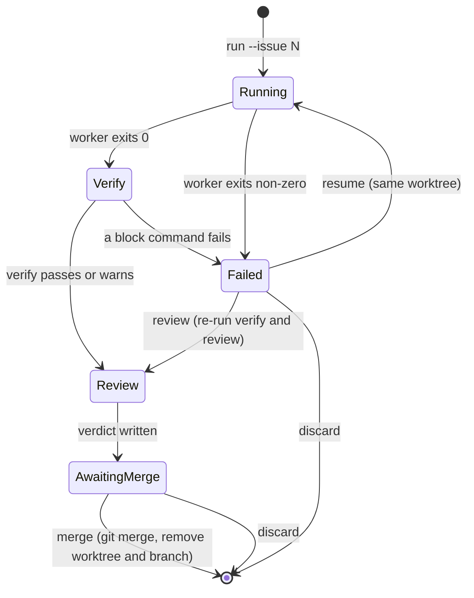

# Dangeresque

Host-native TypeScript CLI that runs Claude Code or Codex headlessly in one git worktree per GitHub issue, runs optional verify commands and a review pass, and lands work only when a human runs `dangeresque merge`. No container. Lighter than [[entities/sandcastle]].

GitHub: https://github.com/slikk66/dangeresque (MIT; 28 stars, 396 commits, no releases, one maintainer; last commit 2026-09-04 as of 2026-10-22). Node >= 22, needs `claude` or `codex`, `gh`, `git`, `jq`; installed by clone + `yarn build` + `npm link`.

> Corrections to the 2026-05 version of this page, which came from a Reddit thread rather than the repo: it is TypeScript, not shell; the reviewer reuses the worker's engine and model unless `review` is configured, so a different model is optional, not built in; and worktree cleanup happens through `merge`/`discard`, which the old page did not mention.

## Run lifecycle

- **Worktree and branch.** `<repo>/.claude/worktrees/dangeresque-<mode>-<issue>` on branch `worktree-dangeresque-<mode>-<issue>`, created with `git worktree add -b` from `refs/remotes/origin/HEAD` (falls back to `HEAD`). It refuses to reuse an existing path. Claude is launched with `--worktree <name>` and its cwd pinned there.
- **Locks.** A PID file in each worktree marks a live worker. `merge` and `discard` refuse while it is alive (`discard --force` stops it). Stale Claude Code locks are cleared when the owning pid is dead. No global concurrency cap was found.
- **Merge gate.** `dangeresque merge <branch>` runs only from the main checkout. It refuses with a live worker or uncommitted paths, runs `mergeGate` commands fail-closed, then a plain local `git merge`; on failure it runs `git merge --abort`. It then removes the worktree and deletes the branch. No PR is created. Workers cannot push; you push `main` yourself after each merge.
- **Verify.** `verify.commands` in `.dangeresque/config.json`: `{name, cmd, on_failure: block|warn, timeout_ms}`, run in the worktree after a rebase onto `origin/main` and before review. Empty by default.
- **Review.** A second session in the same worktree diffs against `origin/HEAD`, checks the worker's claims, and writes `accept`, `reject` or `needs_human_review`.
- **Tool policy.** `allowedTools` / `disallowedTools` in `.dangeresque/config.json`, passed to Claude as `--allowed-tools` / `--disallowed-tools` (defaults block `git push`, `git reset --hard`, `rm -rf`, `git branch -D`); translated into a rules file for Codex. Default `permissionMode` is `acceptEdits`.
- **Artifacts.** `.dangeresque/runs/issue-<N>/<timestamp>-<MODE>.{md,json}` and `.dangeresque/sessions/<worktree>/`, gitignored.
- **Engines.** Claude Code and Codex only. No Pi, no jj. Defaults pin `claude-opus-4-7` (effort max) and `gpt-5.5`.

## Compared with our setup (2026-10-22)

Both sit on Claude Code's native worktrees, so the layout is the same: `.claude/worktrees/<name>` on `worktree-<name>`, branched fresh from origin. The difference is that dangeresque manages a *run*, and we manage a *session*.

| | Dangeresque | Ours |
|---|---|---|
| Unit | one run per issue, resumable | one session or one Pi dispatch; no run identity |
| Cleanup | `merge` / `discard` remove worktree and branch, refused while the worker is alive | manual (`ExitWorktree`); stale worktrees and merged branches accumulate |
| Integration | local `git merge`, human runs it | draft PR, squash merge on GitHub, CI, human merges |
| Agent containment | tool allow/deny lists and a main-checkout check | `commit-funnel`, `reference-transaction` branch guard, Claude Code's worktree guard, agent-review snapshot refs, human-only `approve` dialog |
| Review | same-session reviewer, model optional | agent-review gate, `post-run-verifier`, cross-vendor council on demand |
| Run record | one directory per issue | spread over `.agents/`, `.pi/agent-review/`, pueue logs |
| Engines | Claude Code, Codex | Pi first, plus Claude Code, Codex, OpenCode; jj colocated |

**Verdict: do not adopt it; borrow three ideas.** It cannot drive Pi, would replace the PR flow with local merges, and its containment is the text-matching kind our ref guard was built to back up. Worth taking:

1. **Lifecycle verbs with a liveness lock**: a merge/discard that removes the worktree and branch and refuses while an agent is still running. Fits the session-band worktrees pane (read-only today) or the unbuilt worktree-nav mod.
2. **One record per run** (prompt, model, verify, verdict, worktree, outcome): this is the ticket store already planned for agent-harness Phase B.
3. **Resume and re-review of a crashed run** in its existing worktree.

Running both tools in one repo would be confusing: dangeresque lists every entry under `.claude/worktrees/`, so it would see our session worktrees as runs.

## Related pages

- [[entities/sandcastle]] — heavier alternative with container isolation and branch strategy abstraction
- [[concepts/worktree-isolation]] — the isolation pattern both tools build on
- [[concepts/claude-code-worktree-guard]] — Claude Code's own worktree guard
- [[concepts/multi-vendor-adversarial-review]] — the adversarial reviewer pattern
- [[concepts/agentic-sandbox-controls]] — OS-level sandbox recommendation; host-native as ToS-compliant alternative
- [[concepts/agent-harness]] — harness architecture
- [[concepts/ralph-loop]] — minimal harness pattern
- [[syntheses/lean-agentic-workflow]] — workflow that names dangeresque
- [[syntheses/spec-conformance-and-review-loop-options]] — our review-loop gaps
