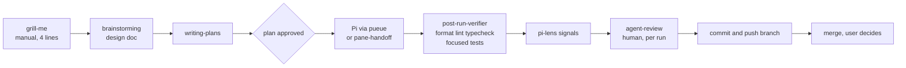
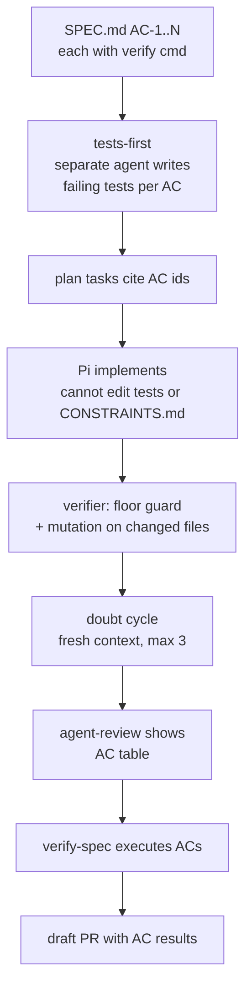

# Spec Conformance and Review Loop Options

Viet's working consensus: `grill-me` is the best part of the workflow, but testing, spec conformance and review loops are thin across the rest of the cycle. This page records the current model as inventoried on 2026-10-15, the verified gaps, and three refactor options. It is a decision aid, not an adopted design. Nothing here is implemented.

## Current model (inventoried from ~/dotfiles and ~/.claude)

| Phase | Covered by | State |
|---|---|---|
| Define | `grill-me` (manual trigger, relaxed mode), superpowers brainstorming | Works; no output artifact |
| Spec | `shared/templates/spec.md` (has Conformance Criteria), brainstorming design docs | Template exists; nothing generates a spec from a grill (to-prd was deleted) |
| Plan | superpowers writing-plans, plan-handoff | Covered |
| Build | Pi dispatch, Claude `worker`, worktrees | Covered |
| Test | Pi `post-run-verifier` (tests run only for behavioral change with nearby coverage), `verify-spec` | Thin |
| Review | agent-review (human), pi-lens, `/judge`, council, `/code-review` | Many gates, one real enforcement point |
| Ship | auto commit/push on branches, deny push to main, gh-stack, optional pre-commit gate | Partial; CI covers only ansible, macOS bootstrap and the wiki |
| Operate | nothing | Sentry MCP configured, no rule or skill uses it |

## Verified gaps

Each was checked against the file itself, not only the inventory.

1. **grill-me ends in conversation.** `claude-setup/skills/grill-me/SKILL.md` is four lines with no output step. The decisions live in chat and are lost unless another skill captures them. Source of the lean-workflow `grill → PRD` hand-off (`to-prd`) no longer exists.
2. **Acceptance criteria are not a durable, checkable contract.** `verify-spec` resolves a spec from a branch-named GitHub issue or `docs/superpowers/specs/*.md`, then a subagent judges each AC by reading code. Its own notes say "reads code, doesn't run it", and runtime ACs fall to UNVERIFIABLE. Test stubs are generated only after an AC fails, and only if the user says yes. It is manual.
3. **The implementer writes its own tests and nothing grades them.** The Pi verifier runs tests, but a vacuous test passes. There is no oracle-strength, mutation or invert-the-condition check ([[concepts/agent-test-verification]]: 80.2% of agent test patches have weak or no oracle signals).
4. **Nothing guards against gaming.** `protect-lint-configs.sh` blocks edits to lint configs. Nothing flags deleted or skipped tests, lowered thresholds, or new suppression comments.
5. **Review has many gates but one hard one, and no bounded loop.** agent-review is a strong human gate per run. `/judge` is manual, the `bin/council` script is missing from dotfiles (it exists in `~/repos/Commandr/bin/council`), and no skill defines a doubt cycle with a stop rule.
6. **No Operate phase.** No post-merge verification, rollback or monitoring workflow.
7. **No single lifecycle doc.** The closest is [[syntheses/lean-agentic-workflow]], which still names tools the inventory did not find installed (`to-prd`, `/issues`, dangeresque, OpenCode plugins). Flagged for a separate cleanup; not changed here.
8. **Skills are untested.** Skill invocation is stochastic and wording-sensitive (agent-skills reports routing gains from one clause, author-reported). Our trigger wording for grill-me and verify-spec has no eval.

## The constraint that shapes every option

The core budget is `skills 22/22, agents 0/0, rules 5/4, hooks 16/18` (session-start hook, `trial-expiry.sh`). Installing the 25-skill pack wholesale would blow the skill budget and duplicate superpowers (brainstorming, TDD, verification-before-completion, review). So every option below ports mechanics into existing skills, rules and hooks instead of adding a pack. This matches [[comparisons/spec-driven-frameworks-vs-native]]: heavy frameworks cost 4 to 5 times the tokens of lean skills.

## Option 1 — Harvest: amend four existing things (smallest)

| Change | Where | Source mechanic |
|---|---|---|
| grill-me ends by writing `SPEC.md`: Objective, ACs each with a verify command, Boundaries (Always/Ask first/Never), Open Questions; then STOP and wait for approval in a later turn | `grill-me/SKILL.md` | agent-skills `spec-driven-development`, `interview-me` |
| `verify-spec` runs each AC's command and records exit code and output; UNVERIFIABLE only when no command exists | `verify-spec/SKILL.md` | Aviator runtime verifier, agent-skills Verification |
| Floor guard: new `CONSTRAINTS.md` plus a diff scan for deleted or skipped tests, lowered thresholds, new suppressions, empty catches; extend `protect-lint-configs.sh` to guard `CONSTRAINTS.md` | hook + one file per repo | agent-skills `constraint-driven-development` |
| Add a Rationalizations table (excuse and rebuttal) to grill-me and verify-spec | the same skills | agent-skills skill anatomy |

Cost: edits to two skills, one hook, one template. No new skills or agents. Risk: ACs written by the model during grill may be vague; the "STOP for approval" gate is the mitigation.

## Option 2 — Spec spine: one contract flows through every phase

Option 1, plus the AC ids travel with the work.

Additions over Option 1: tests-first by a different agent than the implementer (the agent-review work order already does this ad hoc for integration tests Pi must not edit); mutation score on changed files as a verifier stage (start at 60%, ratchet); a doubt cycle defined as a skill section with the stop rules (trivial only, 3 cycles, or user stop) and the "doubt theater" red flag; a PR template that carries the AC table. Cross-vendor review stays optional, because the one controlled study found it asymmetric ([[concepts/agent-test-verification]]).

Cost: one new verifier stage, one prompt change in plan-handoff, one PR template, one doubt section. Risk: process weight grows; mutation runs add minutes per turn on large diffs.

## Option 3 — Gated pipeline with Operate

Option 2, plus enforced phase state: `.agents/phase.json` with transitions blocked by hooks and the pre-commit gate (no BUILD without an approved SPEC, no PR without all ACs PASS), and an Operate phase (post-merge smoke test, Sentry query for new errors, rollback note).

Cost: highest, and Operate has no target today. The inventoried repos are dotfiles and a wiki, which have no deployed service for smoke tests or Sentry to watch. Building Operate now is speculative (YAGNI). Phase enforcement also repeats the ceremony problem of heavy frameworks.

## Recommendation

Do Option 1 now. Pilot Option 2 on the next real code feature and keep the evidence: AC count, ACs passing first run, mutation score before and after, doubt-cycle findings classified actionable vs noise, human minutes in agent-review. Adopt the Option 2 parts that moved those numbers. Defer Option 3 until a deployed service exists; if so, add only the post-merge smoke test and a Sentry check, not phase locks.

Also worth doing regardless: a small routing eval for the grill-me and verify-spec descriptions, because trigger wording changes fire rates (agent-skills approach: positive prompts must rank their skill, negative prompts must hand off). `(claimed, unverified)` for the magnitude; the direction is consistent with [[concepts/agent-skills]].

## Open questions for Viet

- Which repo is the pilot? Spec-conformance needs a code project with runnable tests; dotfiles and the wiki fit only scripted ACs (shellcheck, link checks, `qmd` queries).
- Should ACs be written by the model after grill and approved by Viet (cheap, agrees with agent-skills and Spec Kit), or hand-written (stronger, slower)? Aviator's product docs generate criteria from the built code, which is circular and not recommended here.
- Is the Gemini `/judge` gate worth keeping as a manual step, or fold it into the doubt cycle?

## Related

- [[summaries/addyosmani-agent-skills]] — the mechanics ported above
- [[summaries/aviator-spec-driven-verification]] — measured spec-first case
- [[concepts/agent-test-verification]] — evidence on test strength and review
- [[syntheses/lean-agentic-workflow]] — the earlier workflow; needs reconciling with installed tools
- [[concepts/verification-pipeline]], [[concepts/agentic-cicd]], [[concepts/ai-code-review]]
